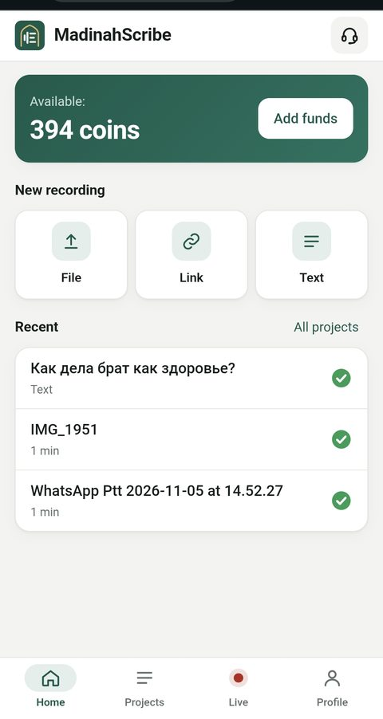
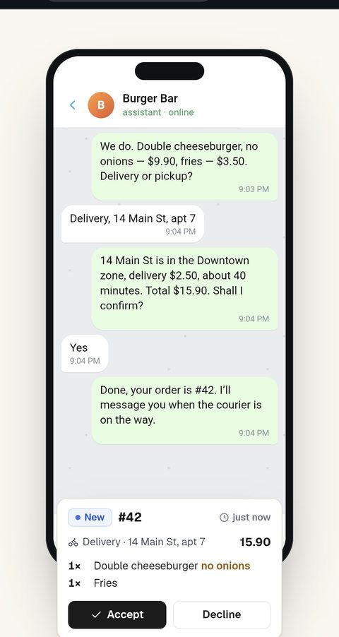
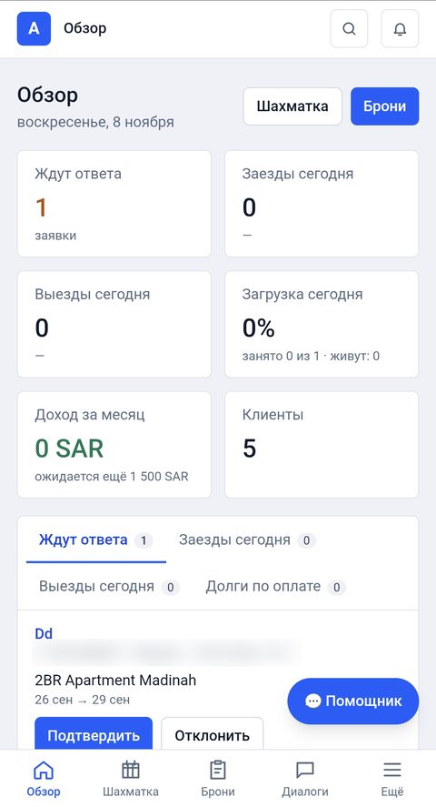
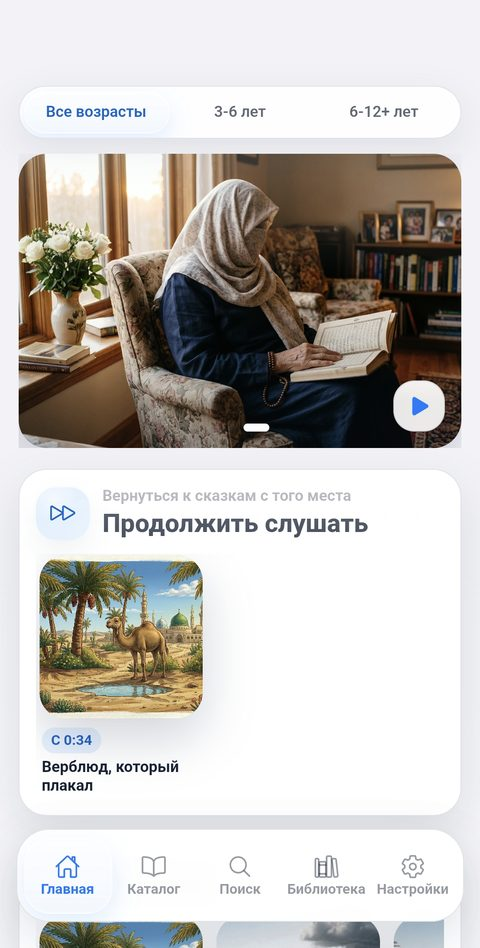
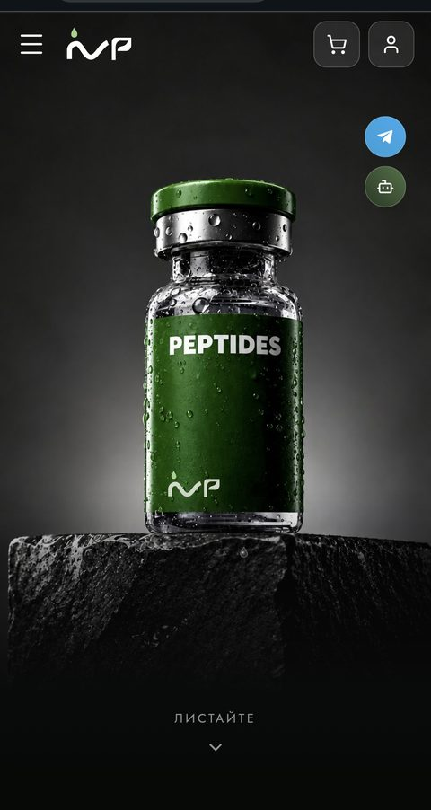

<h1 align="center">Hi, I'm Mukhammat 👋</h1>
<h3 align="center">AI-Powered Full-Stack Developer · TypeScript / Node.js · ERPNext</h3>

  Backend at the core, full stack with AI: I build web services, SaaS products and Telegram bots end to end, 
  from APIs and databases to frontends, ERP systems on ERPNext and deployment on Cloudflare Workers and Docker.

  

---

### 👨‍💻 About me

I've been programming since **2016**. I started with **Java**, learning it through the SoloLearn app,
then practicing on my laptop by solving all kinds of coding problems.

In **2017** I enrolled at the **IT STEP Academy**. Over about a year and a half I studied
**C++** first and then **C#** with **ASP.NET**. Before finishing the program I left the academy to start working
and began taking on **freelance** projects.

Along the way I learned **frontend development** (HTML, CSS, JavaScript) and built websites and landing pages for clients.
Then a developer I knew suggested I learn **PHP**. It took me about two months, and he started giving me tasks:
first practice assignments, then **real paid tasks** from the company he worked for. I kept doing that work
until the end of **2019**.

From **2019 to 2023** I lived and studied in **Medina, Saudi Arabia**. During those years I also spent time in
the **UAE** (about a year), **Turkey** (3 months), **Egypt** (2 months), **Morocco**, **Tunisia** and **Jordan** (a month each).
That experience taught me to adapt quickly and to work with people from different cultures.

In **August 2023** I joined **Corinno**, a Russian company where a team of about 15 people was building
a large **freelance marketplace**. I worked there for about a year and a half.

After that I went back to **freelancing**:

- **Jun – Sep 2025: [Caravan](https://github.com/mukhammat/caravan)** (client project). A monorepo with a property booking
  platform (properties, bookings, Stripe payments, a Telegram bot with sign-up and chat with a manager)
  and a CRM (orders, services, employees, Telegram notifications, real-time updates over WebSockets, Vue dashboard).
- **Sep – Dec 2025: [CRM system](https://github.com/mukhammat/crm_bakhodur)** (client project). Task management with roles and permissions,
  task assignment and statuses, push notifications via Firebase, a Telegram bot, a React web app and a React Native (Expo) mobile app.

I also work with **ERP systems on [ERPNext](https://erpnext.com)** (Frappe Framework). For a **burger restaurant**
I customized ERPNext and adapted it to the way the restaurant runs its business.

**How I work.** Until 2025 I wrote all my code by hand. In **2025** I started using **Cursor** for AI-assisted development,
used it for about six months, and then switched to **[Claude Code](https://claude.com/claude-code)**, which is now my main tool.
I like building on **serverless** platforms: **Cloudflare Workers** (D1, KV, R2), **Supabase** and similar services.

In **early 2026** (January – April) I built **[Muslim Kids Stories](https://play.google.com/store/apps/details?id=com.muslimstory.app)**, an Android app with Angular and Capacitor.

In **2026** we launched our own products: **[Cafe Habibi](https://cafe.habibi-erp.com)**, an AI ordering assistant for restaurants,
in **July 2026**, and **[Madinah Scribe](https://madinahscribe.net)**, an AI transcription service, in **September 2026**.

My background is backend, but with AI tools I now work as an **AI-powered full-stack developer**: I build
**frontends** as well as backends, and I handle the **DevOps basics** myself (servers, Docker, Nginx, CI/CD, deployment).
I've been using **Ubuntu** as my main development environment since **2017**.

Today I focus on **full-stack development with TypeScript and Node.js** and **ERP development on ERPNext**:
SaaS products, ERP and CRM systems, Telegram bots and AI-powered services.

---

### 🗓 Timeline

| Year | Milestone |
|---|---|
| **2016** | Started programming with Java (SoloLearn + self-practice) |
| **2017** | IT STEP Academy: C++, then C# / ASP.NET (~1.5 years); switched to Ubuntu as main dev environment |
| **~2018–2019** | Freelance: frontend websites & landing pages, then paid PHP tasks |
| **2019–2023** | Studied in Medina, Saudi Arabia; also lived in the UAE, Turkey, Egypt, Morocco, Tunisia, Jordan |
| **2023–2025** | Corinno: ~1.5 years in a team of ~15 building a freelance marketplace |
| **2025** | Started AI-assisted development: Cursor (~6 months), then Claude Code |
| **2025** | Freelance: Caravan (Jun–Sep), CRM system (Sep–Dec) and other client projects |
| **Jan–Apr 2026** | Built Muslim Kids Stories, an Android app (Angular + Capacitor) |
| **Jul 2026** | Launched [Cafe Habibi](https://cafe.habibi-erp.com) |
| **Sep 2026** | Launched [Madinah Scribe](https://madinahscribe.net) |
| **Now** | AI-powered full-stack & ERP developer: TypeScript, Node.js, React, ERPNext / Frappe, DevOps basics |

---

### 🛠 Tech stack

  
  
  
  
  
  
  
  
  
  
  
  
  
  
  

**Backend:** Node.js, TypeScript, Express, NestJS, Hono, Zod 
**Frontend:** React, Vue, Angular, HTML, CSS / SCSS 
**Mobile:** Angular + Capacitor (Android), React Native (Expo) 
**ERP:** ERPNext, Frappe Framework 
**Databases:** PostgreSQL, Drizzle ORM, Supabase, Cloudflare D1 / KV 
**Serverless:** Cloudflare Workers (D1, KV, R2), Supabase 
**DevOps (basics):** Ubuntu / Linux, Docker, Docker Compose, Nginx, GitHub Actions, deployment scripts 
**AI tools:** Claude Code, Cursor 
**Other:** Telegram Bot API, OpenAPI, AI integrations 
**Also worked with:** PHP, C#, ASP.NET, C++, Java, Python

---

### 💡 What I can do for you

- 🤖 **AI assistants for business**: chatbots that take orders, answer customers and book appointments (like Cafe Habibi)
- 🚀 **SaaS & MVPs end to end**: from idea to a launched product with payments, admin panel and analytics
- 💬 **Telegram bots & mini apps**: sales, bookings, notifications, CRM integrations
- 🛒 **Online stores & websites**: catalogs, carts, payments, fast hosting on Cloudflare
- 🏢 **CRM & ERP systems**: custom CRMs, ERPNext setup and customization for your business
- 📱 **Mobile apps**: Android / iOS apps with Angular + Capacitor or React Native
- ⚙️ **Backend & APIs**: REST APIs, databases, integrations, deployment and DevOps

---

### 🌐 Live products

| Product | What it is | Launched | Link |
|---|---|---|---|
| 📜 **Madinah Scribe** | AI transcription service: upload a file, paste a link or record live and get the text. Pay-as-you-go coin balance, top-ups and a referral program | Sep 2026 | [madinahscribe.net](https://madinahscribe.net) |
| ☕ **Cafe Habibi** | AI ordering assistant for cafes and restaurants: chats with customers, takes orders with modifiers, calculates delivery by zone and sends orders to staff to accept or decline | Jul 2026 | [cafe.habibi-erp.com](https://cafe.habibi-erp.com) |
| 🏠 **Realty SaaS** | Property management for short-term rentals: availability grid, bookings, properties and buildings, clients, finances, team roles, an AI assistant, a website builder and a Telegram bot | 2026 | [repo](https://github.com/mukhammat/realty-saas) |
| 🧪 **IVPEPTIDE** | Client project. E-commerce store for peptides with a cart, customer accounts, Telegram contact and a chat assistant | 2026 | [ivpeptide.com](https://ivpeptide.com) |
| 📱 **Muslim Kids Stories** | Android app with audio stories for Muslim kids: age filters (3–6, 6–12+), catalog, search, personal library, "continue listening", light/dark theme and family accounts | 2026 | [Google Play](https://play.google.com/store/apps/details?id=com.muslimstory.app) |
| 🗂 **Nadeck** | Client project | | [nadeck.net](https://nadeck.net) |

<table>
  <tr>
    <td align="center"> <b>Madinah Scribe</b></td>
    <td align="center"> <b>Cafe Habibi</b></td>
    <td align="center"> <b>Realty SaaS</b></td>
    <td align="center"> <b>Muslim Kids Stories</b></td>
    <td align="center"> <b>IVPEPTIDE</b></td>
  </tr>
</table>

### 🚀 Featured projects

| Project | Description | Stack |
|---|---|---|
| 🐪 [**caravan**](https://github.com/mukhammat/caravan) | Client project (Jun–Sep 2025): property booking platform with Stripe payments and a Telegram bot, plus a CRM with orders, employees and real-time WebSocket updates | TypeScript, Hono, PostgreSQL, Drizzle, Redis, grammY, Stripe, Vue |
| 🍔 **ERPNext for a burger restaurant** | Client project: customized ERPNext and adapted it to a burger restaurant's business processes | ERPNext, Frappe Framework |
| 💼 [**crm_bakhodur**](https://github.com/mukhammat/crm_bakhodur) | Client project (Sep–Dec 2025): CRM with tasks, roles & permissions, Firebase push notifications, Telegram bot, web and mobile apps | TypeScript, Hono, PostgreSQL, Drizzle, Redis, React, React Native (Expo), Docker |
| 🌴 [**saudisukkari**](https://github.com/mukhammat/saudisukkari) · [**live**](https://saudisukkari.dosnet2200.workers.dev) | Website for Saudi Sukkari, an importer of products from Saudi Arabia | HTML, Cloudflare Workers |
| 🚚 [**tow-track-server**](https://github.com/mukhammat/tow-track-server) | Backend for a tow truck service | TypeScript, Express, Zod, PostgreSQL, Drizzle, Docker |
| 📋 [**RequestTrack**](https://github.com/mukhammat/RequestTrack) | Backend for a request tracking system | TypeScript, Express, Zod, PostgreSQL, Drizzle, Docker |
| 🏨 [**hotel-ai-system**](https://github.com/mukhammat/hotel-ai-system) | Hotel management system with AI features | TypeScript |

<b>More projects: e-commerce, Telegram bots, AI tools, templates and learning projects</b>

#### 🧩 Other projects

| Project | Description | Stack |
|---|---|---|
| 🧴 [**perfumeshop-server**](https://github.com/mukhammat/perfumeshop-server) + [**frontend**](https://github.com/mukhammat/perfumeshop-frontend) | Perfume e-commerce store: server and client | TypeScript, SCSS |
| 🛒 [**storefront-kit**](https://github.com/mukhammat/storefront-kit) | Toolkit for quickly launching an online storefront | TypeScript |
| 🔗 [**shortlink_server**](https://github.com/mukhammat/shortlink_server) | URL shortener service | Node.js |
| 🔌 [**my-socket**](https://github.com/mukhammat/my-socket) | Real-time communication over WebSockets | TypeScript |

#### 🤖 Telegram bots

- [**polufabrikati-bot**](https://github.com/mukhammat/polufabrikati-bot): bot for ordering semi-finished food products (Cloudflare Workers, Hono, OpenAPI)
- [**dosnetsprint-bot**](https://github.com/mukhammat/dosnetsprint-bot): Telegram bot in TypeScript
- [**abdella_tg_bot**](https://github.com/mukhammat/abdella_tg_bot) · [**dosmukhamed_bot**](https://github.com/mukhammat/dosmukhamed_bot) · [**mytelegram**](https://github.com/mukhammat/mytelegram)

#### 🧠 AI & automation

- [**audio2textai**](https://github.com/mukhammat/audio2textai): speech-to-text transcription (Python)
- [**FromScreenToAudioWithTranslate**](https://github.com/mukhammat/FromScreenToAudioWithTranslate): on-screen text → translation → speech
- [**parsingv2**](https://github.com/mukhammat/parsingv2): data parser

#### 🧰 Templates & learning projects

- [**typescript-express-starter**](https://github.com/mukhammat/typescript-express-starter): TypeScript + Express starter template
- [**StoreAPI**](https://github.com/mukhammat/StoreAPI) · [**TaskManager**](https://github.com/mukhammat/TaskManager) · [**Note-Taking-App**](https://github.com/mukhammat/Note-Taking-App) · [**Library**](https://github.com/mukhammat/Library) · [**php-db**](https://github.com/mukhammat/php-db) · [**learning**](https://github.com/mukhammat/learning)

---

### 📊 GitHub stats

  
  

---

### 🌍 Languages

🇷🇺 Russian · 🇸🇦 Arabic · 🇬🇧 English · 🇰🇿 Kazakh · 🇺🇿 Uzbek

---

### 📫 Get in touch

Open to job offers and freelance projects.

  
  
  

